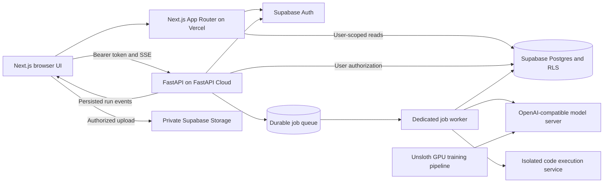

# Synaptiq production rebuild plan

This is the proposed implementation following the source audit. It is not a claim that these components exist or have passed deployment checks.

## Architecture



The API orchestrates work. GPU training/inference and untrusted code execution have separate operational boundaries. Their hosting and credentials must be selected explicitly; there is no assumption that Vercel or FastAPI Cloud supplies a GPU or a code sandbox.

FastAPI Cloud documents request autoscaling and default scale-to-zero, so long-running jobs must not depend on a daemon thread inside a request-serving instance. Use a dedicated supervised worker with durable jobs and recovery. [FastAPI Cloud deployment lifecycle](https://fastapicloud.com/docs/builds-and-deployments/how-it-works/)

## Repository shape

```text
synaptiq/
  AGENTS.md
  README.md
  frontend/
    src/app/                 # Auth, dashboard, challenges, projects, assessments, reports
    src/components/          # UI, motion primitives, editor, feature components
    src/lib/                 # Validated env, API client, Supabase SSR/browser clients
    src/proxy.ts             # Session refresh/route checks for current Next.js convention
    tests/
    package.json
    package-lock.json
    .env.example
  backend/
    app/main.py
    app/api/v1/              # Resource routers
    app/core/                # Settings, auth, errors, logging
    app/models/              # Strict Pydantic input/output contracts
    app/services/            # Learning, projects, runs, provider adapters
    app/repositories/        # Persistence and transactions
    app/workers/             # Job handlers; separate runtime
    tests/
    pyproject.toml
    uv.lock
    .env.example
    .fastapicloudignore
  packages/contracts/        # OpenAPI-generated TypeScript and event schema
  supabase/                  # Version-pinned local config, migrations, seeds, RLS tests
  infrastructure/            # Worker/executor deployment definitions and runbooks
  .github/workflows/         # CI and deploy workflows
  docs/                      # Architecture, migration, operations, model evaluation
```

Pin actual dependency versions and supported Node/Python runtimes at scaffold time; commit both lockfiles. Retain the original prototype outside the new application's deployment source. `AGENTS.md` will describe setup, commands, module boundaries, schema generation, environment ownership, and required checks.

## Data design

Start with one personal workspace per user, with membership records ready for shared workspaces. Keep learner assessments private by owner; do not imply instructor or organization-wide access without an explicit product requirement.

| Entity | Purpose and constraints |
| --- | --- |
| `auth.users`, `auth.sessions` | Supabase-managed identity/auth sessions; no duplicate password store or public auth-token table. |
| `profiles` | UUID PK/FK to `auth.users`, display preferences and timestamps. |
| `workspaces`, `workspace_members` | Workspace identity and membership; unique `(workspace_id,user_id)`; explicit owner/member roles with protected membership mutation. |
| `projects`, `project_files`, `file_revisions` | Workspace-owned projects, normalized paths, immutable source revisions/storage references and checksums. Unique project/path; optimistic draft revision. |
| `challenges`, `challenge_versions`, `lessons` | Versioned learning catalog preserving legacy challenge IDs. Public challenge DTO excludes reference solutions and hidden tests. |
| Private challenge cases/references | Non-exposed schema or tightly restricted storage; readable by the grading worker only. |
| `learning_sessions` | Product practice/assessment sessions, distinct from auth sessions; owner, mode, immutable assistance policy, UTC start/deadline, state. |
| `attempts`, `attempt_revisions`, `test_runs` | Draft history and evaluated revisions, result hashes, public/hidden result visibility, terminal state and submission idempotency. |
| `hint_events`, `reflections`, `assessment_events` | Durable hint history, learner explanations/confidence, and limited browser event metadata. No camera footage. |
| `ai_runs`, `ai_run_events` | Model/adapter and prompt version, status, ordered sequence, bounded output, usage, latency and sanitized error metadata. |
| Private `jobs` | Queue kind, resource IDs, idempotency key, lease/heartbeat, attempt count, retry time and terminal status. Worker-only mutation. |
| `document_chunks` | Optional retrieval chunks associated with project/file revision; content hash, embedding model/version/dimension and vector. Add once the embedding provider is selected. |

RLS and grants will distinguish public catalog reads, private learner records, workspace resources, and worker-owned results. Index policy/FK columns, membership lookups and common `(workspace_id,created_at)` / `(session_id,created_at)` access paths. Enforce same-workspace relationships with composite constraints or validated transactional writes. Users cannot set their own role, forge grades or move records across workspaces.

Use user-scoped database access for ordinary API operations. Any privileged worker path validates ownership from a trusted job record and uses minimal credentials. Keep privileged functions out of exposed schemas and test their search paths/grants. Storage object policies must enforce the same workspace ownership as database rows.

Semantic retrieval is applicable to imported projects and lesson context, but is not needed for the first functional migration. Choose an embedding model before defining fixed vector dimensions. Add a matching pgvector/HNSW index, revision-aware reindexing and tenant-scoped retrieval tests; do not mix dimensions or model versions in one search space.

## Ordered execution

1. **Freeze behavior and establish contracts.** Preserve catalog and branding; convert the reproduced defects into tests for correct behavior in the new application. Scaffold `/frontend` and a new uv-backed `/backend` using the FastAPI New skill. Establish strict TypeScript, linting, Python typing, validated environment models and OpenAPI generation.
2. **Build database and authentication.** Create local migrations/seed data, RLS/grant tests and storage policies. Implement Supabase Auth signup/login/logout/reset/GitHub callback; protected layouts and server identity checks. Add a resumable legacy progress importer with ID mapping and explicit credential migration/reset decisions. The ZIP contains no live account database to migrate now.
3. **Build the Python domain/API layer.** Port challenge rules and static checks into services; split routes into workspaces, projects/files, sessions, attempts, hints, reports and runs. Replace the global lock with transactions and bounded execution. Bind save/run/reflect/submit to explicit IDs and source revisions. Implement durable deadlines, idempotent submission and paginated reports.
4. **Add execution and AI services.** Integrate the isolated runner; implement an async OpenAI-compatible adapter, SSE events, strict final JSON schemas, cancellation, bounded timeout/retries and model quotas. Add durable queued analysis/embedding/fine-tuning jobs and worker recovery. Provide a clear provider-unavailable state until an actual endpoint is configured.
5. **Rebuild the interface component by component.** Auth and shell, overview, challenge workspace, assessment, project editor, then reports/settings. Use Tailwind tokens for obsidian/slate surfaces, `border-white/10`, violet/mint accents, crisp typography and restrained glass layers. Add React Bits spotlight cards, motion spring interactions, shared `layoutId` tabs, `AnimatePresence` dialogs/drawers, skeletons and reduced-motion behavior. Preserve focus, cursor, selection and drafts during updates.
6. **Verify and prepare deployment.** Run all release gates locally/CI, inspect RLS advisors, rehearse migration and rollback, validate secret/build boundaries, create preview deployment configuration for Vercel and FastAPI Cloud, then verify hosted authentication, streaming and persistence against the chosen project.

Current Next.js guidance calls the request interception file `proxy.ts`; it supports redirects/session refresh but is not the sole authorization boundary. Use verified identity and access checks in server data operations and API endpoints. [Next.js authentication guide](https://nextjs.org/docs/app/guides/authentication)

Use `@supabase/ssr` cookies and verified claims; request a fresh Auth user where current session/user state is required. Do not authorize from an unverified `getSession().user`. [Supabase Next.js guide](https://supabase.com/docs/guides/getting-started/tutorials/with-nextjs)

## API and AI contracts

- Versioned `/v1` resource routes with strict Pydantic v2 inputs/outputs, bounded strings/files, UUIDs, enums, explicit error codes and request IDs. Unknown JSON becomes validated `unknown`/recursive JSON types in TypeScript, never `any`.
- Frontend SSR reads and browser API requests carry the user context. FastAPI verifies token signature, issuer, audience and expiry, then verifies membership/ownership. CORS permits exact configured frontend origins; preview origins must be explicitly managed, with no wildcard credentials configuration.
- Create an AI run with an idempotency key; subscribe with authenticated streaming fetch. Events include run ID, monotonic sequence and one of `queued`, `started`, `delta`, `completed`, `failed`, `cancelled`. Reconnect by cursor; propagate cancellation and disconnect policy; use heartbeat and no-buffering headers. Only the final validated payload becomes a structured result.
- Structured outputs include diagnostics, severity, evidence, file/revision/line references, explanation and suggested patch. Unsupported provider JSON-schema features are detected explicitly. Invalid output is rejected or retried within a bound, never silently accepted as a valid diagnosis.
- Server configuration selects allowed model base URLs; user requests cannot supply arbitrary outbound URLs. Keep model tokens and provider credentials server-side. Treat repository content as untrusted model input; it cannot override system policy or trigger execution.
- Fine-tuning is a separately scheduled Unsloth GPU job with dataset provenance, explicit training-data inclusion, adapter/model versioning, evaluation and promotion. Serve the resulting model through a compatible server such as vLLM. [Unsloth deployment guidance](https://unsloth.ai/docs/basics/inference-and-deployment/vllm-guide)
- Deterministic test results remain the grading evidence. Model explanations are advisory; measure usefulness, hallucinated file/line references and unintended answer disclosure before enabling them in learning flows.

## Environment and deployment boundaries

| Scope | Planned configuration |
| --- | --- |
| Public frontend | `NEXT_PUBLIC_SUPABASE_URL`, `NEXT_PUBLIC_SUPABASE_PUBLISHABLE_KEY`, `NEXT_PUBLIC_API_URL` |
| Frontend server | `APP_ORIGIN`, server API URL if distinct; no model or privileged database key in browser bundles |
| API | `APP_ENV`, `ALLOWED_ORIGINS`, `SUPABASE_URL`, publishable key, expected JWT issuer/audience, validated model base URL/model/API key, timeouts, quotas, executor endpoint/auth |
| Worker | Restricted database/queue credentials, storage access, provider credentials, allowed job types, lease/retry and concurrency limits |
| CI/deploy | Scoped GitHub deployment credentials, Vercel project/team selection, FastAPI Cloud app/deploy token and Supabase migration target credentials in secret storage |

All environment examples contain placeholders only. Validate production origins, redirect URLs, provider availability and runtime settings at startup/deploy; never print secret values in diagnostics. Use expand/contract migrations and a single controlled migration stage before rolling API changes. Document rollback behavior and run a database restore rehearsal.

Supabase's current changelog reports CLI v3 changes to local/hosted targeting and CI behavior. Pin the CLI and discover the installed command surface before writing migration automation; do not copy old linked-project defaults. [Supabase CLI v3 announcement](https://supabase.com/changelog/supabase-cli-v3)

## Release gates

| Layer | Required evidence |
| --- | --- |
| Frontend | Strict `tsc --noEmit`, ESLint including no-explicit-any/unsafe access, production Next.js build, no ignored build errors; dependency lock reproducibility. |
| UI workflows | Browser checks for signup/signin, signout on mobile, session expiry, project import, failed saves, navigation during saving, tab/file switching, filtering, assessment start/deadline/submission, reports and reconnect. Keyboard, focus, contrast and reduced-motion checks. |
| Backend | Ruff, strict typing, API integration tests, validation/auth/CORS tests, contract generation drift check, Windows/Linux portability where supported. |
| Correctness | Every grade references the exact source revision; concurrent edits never silently overwrite; repeated submission is idempotent; reconnect restores hints, drafts and history. |
| Database | Migration from empty and previous schema; owner/member/non-member/anonymous RLS tests; malicious cross-workspace references and role escalation denied; advisor review. |
| AI/queue | SSE parsing across split chunks, provider timeout, invalid JSON, cancellation, disconnected client, retry, worker crash/restart and lease recovery. No duplicate completed run on repeated job delivery. |
| Execution | Timeout, memory/output exhaustion, process/network/filesystem restrictions and secret isolation tested against the selected sandbox. No production enablement based on AST restrictions alone. |
| Deployment | Vercel preview build, FastAPI health/readiness, exact CORS/auth redirects, actual configured model smoke test, cross-device persistence, deployment logs and rollback rehearsal. |

Live dependencies still to resolve: the intended active Supabase project, Vercel team access, FastAPI Cloud app/account, repository target, and the inference/GPU/executor endpoints. They do not prevent local scaffolding, migration authoring, typed interfaces or offline tests. No paid infrastructure, production schema or deployment was created during this audit.
